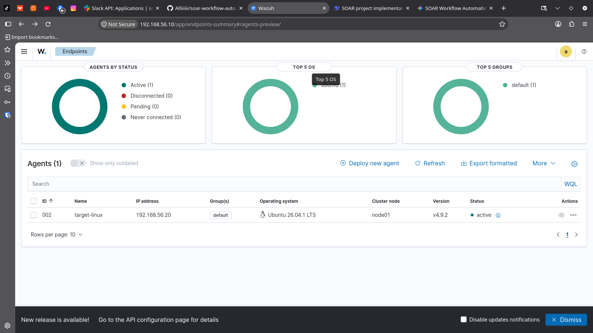
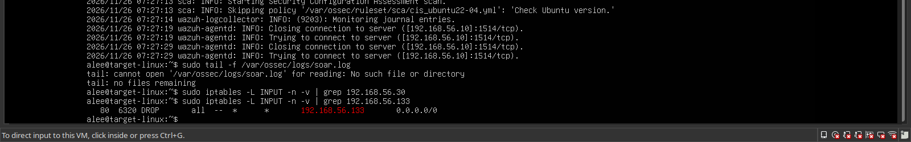
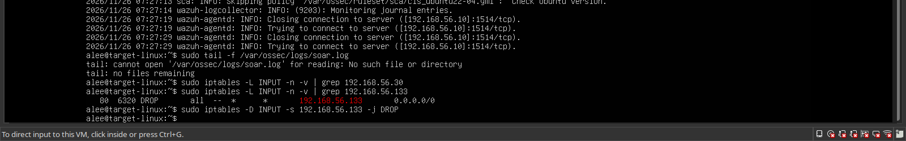
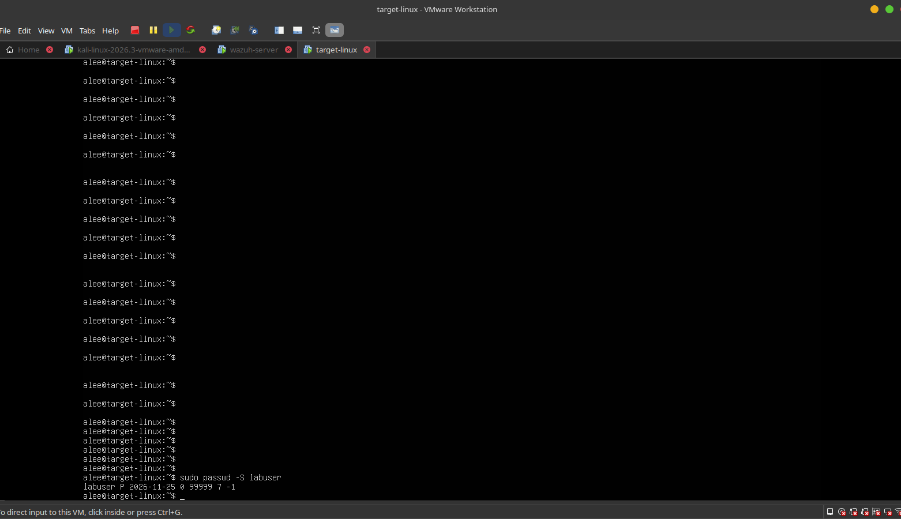
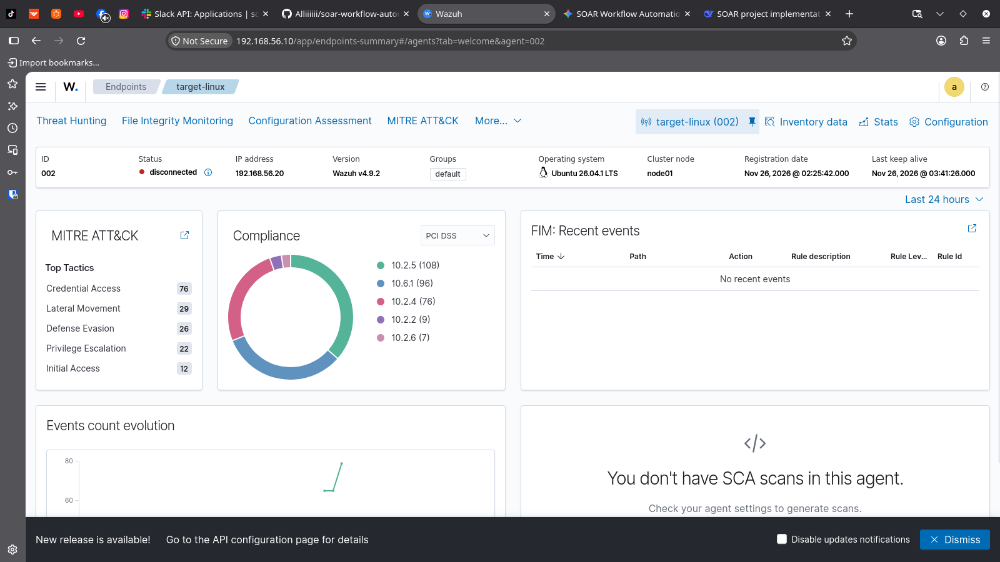

# SOAR Workflow Automation for Incident Response

Automated IP blocking and account disabling driven by Wazuh SIEM, with Slack and email notifications.

**Course:** Information Security — BSIT Part III, University of Sindh, Jamshoro
**Author:** Ali
**Date:** 25 November 2026

---

## 1. Abstract

Security teams receive far more alerts than analysts can triage by hand. A brute-force
attack against SSH can generate hundreds of failed logins per minute. This project
designs, implements and tests a **SOAR (Security Orchestration, Automation and Response)**
workflow that closes the gap between detection and containment.

Wazuh is used as the SIEM/XDR platform. When a detection rule of sufficient severity
fires, a custom Python integration (`custom-soar.py`) selects a playbook, applies
guardrails (whitelist, protected accounts, cooldown, optional IP reputation), and either
blocks the offending IP address or disables the compromised account through Wazuh
Active Response. Every action is reported to analysts via **Slack** and **email**, and
written to an audit log. An equivalent **Shuffle SOAR** design and an alternative
**Splunk** integration are also documented.

---

## 2. Architecture

```
+----------------+    SSH/HTTP     +---------------------+
| Attacker       | --------------> | Monitored Endpoints |
| (Kali Linux)   |                 | Ubuntu, SSH, Apache |
+----------------+                 +----------+----------+
                                             | logs (1514/tcp)
                                             v
                            +----------------------------------+
                            | SIEM: Wazuh Manager + Indexer   |
                            | decode -> rule match -> alert    |
                            | level >= 10 triggers integration |
                            +----------------+-----------------+
                                             | alert JSON
                                             v
                            +----------------------------------+
                            | SOAR Orchestration Layer         |
                            | playbook | whitelist | cooldown |
                            | reputation | audit log         |
                            +----+-------------+-------------+
                                 |             |
                                 v             v
                        +----------------+  +-------------------+
                        | Block IP       |  | Disable Account   |
                        | firewall-drop  |  | disable-account   |
                        +----------------+  +-------------------+
                                 |
                                 v
                        +-------------------+
                        | Notify            |
                        | Slack + SMTP mail |
                        +-------------------+
```

Enforcement runs on the agent through Wazuh **Active Response**.

**Data flow:**
1. Attacker generates repeated failed logins / malicious HTTP requests.
2. Target logs to `/var/log/auth.log` and Apache logs.
3. Wazuh agent forwards events over 1514/tcp.
4. Manager decodes and evaluates rules. Correlated alert fires (rule 5712/5763/31151/100100, level >= 10).
5. `integratord` invokes `custom-soar.py` with the alert JSON.
6. Playbook selected; guardrails applied; optional reputation lookup.
7. Native mode: Active Response enforces. API mode: SOAR calls Wazuh REST API.
8. Slack + email notification sent; decision appended to `soar.log`.
9. After timeout, block/lock automatically reversed.

---

## 3. Environment

| Host | Role | IP |
|------|------|-----|
| wazuh-server | Ubuntu 22.04 — manager, indexer, dashboard, custom-soar | 192.168.56.10 |
| target-linux | Ubuntu 22.04 — agent, OpenSSH, Apache2 | 192.168.56.20 |
| attacker | Kali Linux — hydra, nikto, nmap | 192.168.56.133 (earlier notes: `.30`) |
| host/admin | Browser | 192.168.56.1 |
| shuffle-server (optional) | Ubuntu + Docker — Shuffle SOAR | 192.168.56.40 |

> The Kali VM was moved from `192.168.56.30` to `192.168.56.133` during the
> lab. Commands and screenshots in this repository use `.133` unless an older
> note explicitly says `.30`.

---

> **Deployment note:** The lab was executed on **Ubuntu 26.04 LTS**
> (the version installed during development) rather than 22.04 LTS
> as originally planned. All playbooks, rules, and integrations were
> verified working on this version. The only compatibility adjustment
> was setting `vm.max_map_count=262144` before installing the Wazuh
> Indexer (a hard requirement of the OpenSearch-based indexer).

---

**Ports:** 1514/tcp (agent events), 1515/tcp (enrolment), 55000/tcp (REST API), 443/tcp (dashboard), 9200/tcp (indexer), 3001/3443/tcp (Shuffle), 587/tcp (SMTP), 443/tcp (Slack / AbuseIPDB outbound).

**Test accounts on target:** `labuser` (victim), `analyst` (protected, key-based), `root` (protected, remote login disabled).

---

## 4. Quick Start

### 4.1 Install the Wazuh server (all-in-one)
```bash
# On wazuh-server (192.168.56.10)
sudo bash scripts/install-wazuh-server.sh
```
Visit https://192.168.56.10 — sign in as `admin`.

### 4.2 Install and enrol the Wazuh agent
```bash
# On target-linux (192.168.56.20)
sudo bash scripts/install-wazuh-agent.sh
```
Confirm in Dashboard -> Agents that `target-linux` is **Active**.

### 4.3 Deploy detection rules and Active Response
```bash
# On wazuh-server
sudo cp wazuh/manager/local_rules.xml /var/ossec/etc/rules/local_rules.xml
# Merge wazuh/manager/ossec.conf.snippet.xml into /var/ossec/etc/ossec.conf
sudo /var/ossec/bin/wazuh-logtest          # validate rule 100100
sudo systemctl restart wazuh-manager
```

### 4.4 Deploy custom-soar
```bash
# On wazuh-server
sudo cp -r soar /opt/custom-soar
sudo cp /opt/custom-soar/config.yaml.example /opt/custom-soar/config.yaml
sudo nano /opt/custom-soar/config.yaml     # fill in Slack + SMTP + API creds
sudo pip3 install -r /opt/custom-soar/requirements.txt
chmod +x /opt/custom-soar/custom-soar.py
# Bind the integration (see wazuh/manager/ossec.conf.snippet.xml)
```

Wazuh's `integratord` invokes `/var/ossec/integrations/custom-soar` (or
`custom-soar.py`) directly, so create a tiny wrapper that points at the deployed
engine and give it the ownership Wazuh expects:

```bash
sudo tee /var/ossec/integrations/custom-soar <<'EOF'
#!/bin/sh
exec /usr/bin/python3 /opt/custom-soar/custom-soar.py "$1"
EOF
sudo chmod 750 /var/ossec/integrations/custom-soar
sudo chown root:wazuh /var/ossec/integrations/custom-soar
```

Without this wrapper the `<integration>` block has nothing to execute and no
alerts are processed. The engine reads the alert path from `argv[1]`.

### 4.5 Verify detections
```bash
bash scripts/verify-detections.sh
```

### 4.6 Simulate an attack (lab only)
```bash
bash tests/attack-simulation.sh
# Observe Slack #soc-alerts + analyst mailbox
tail -f /var/ossec/logs/integrations/soar.log
```

### 4.7 Run unit tests
```bash
pytest -v tests/
```

---

## 5. Safety

> **IMPORTANT:** Brute-force and scanning tools (`hydra`, `nikto`, `nmap`) are used **only** inside the isolated lab network `192.168.56.0/24`, on systems owned by the project team. Attack tools must **never** be used against systems without written permission. `tests/attack-simulation.sh` refuses to run against any IP outside `192.168.56.0/24`.

---

## 6. Limitations

- `disable-account` locks the password (`passwd -l`) but does **not** block SSH key logins. For key-based accounts the runbook recommends `usermod --expiredate 1` plus `pkill -KILL -u USER`, or a custom active-response script.
- Rule `100100` is a two-rule correlation: helper `100099` fires after 6 SSH failures from the same IP in 300 s, then `100100` fires on the next successful login within the same window. `wazuh-logtest` does not maintain `frequency` state across events, so validate the chain with a live event (or `tests/attack-simulation.sh`), not logtest alone.
- The `100099` threshold is deliberately below rule `5763` (8 failures / 120 s) so `pb02` is evaluated before `pb01`. If `5763` fires first, the cooldown guardrail suppresses `pb02`'s duplicate actions for that IP.
- API mode auto-expiry of Active Response depends on Wazuh version; the analyst runbook covers manual reversal.
- Windows AD account disabling is out of scope (future work).

---

## 7. Troubleshooting

Deployment issues encountered during lab setup and their verified fixes are
documented in [`docs/TROUBLESHOOTING.md`](docs/TROUBLESHOOTING.md).

| Issue | Quick fix |
|---|---|
| VMware `/dev/vmmon` missing / monitor init failure | `sudo vmware-modconfig --console --install-all && sudo systemctl restart vmware` (enrol MOK or disable Secure Boot if blocked) |
| Wazuh API HTTP 429 / `ERROR3099` | Raise `max_request_per_minute: 1000` under `access:` in `/var/ossec/api/configuration/api.yaml`, restart `wazuh-manager` |
| Dashboard `timeout of 20000ms exceeded` / YAML stream error | Put `timeout: 60000` directly below `---` in `wazuh.yml`, validate with `yaml.safe_load`, restart `wazuh-dashboard` |

---

## 8. Live Validation & Results

Validated on the lab network on **26 November 2026**. The authoritative `pb02`
run used seven synthetic SSH failures followed by one success from
`192.168.56.145`, injected through the manager queue socket so the test does
not depend on the attacker VM's credentials. Raw alert extracts are in
[`docs/evidence/live_alerts_2026-11-26.json`](docs/evidence/live_alerts_2026-11-26.json).

### 8.1 Agent health


The dashboard shows agent `002` (`target-linux`, `192.168.56.20`, Wazuh
`v4.9.2`) in the **active** state.

### 8.2 Detection and correlation
The helper rule `100099` fired after six failed logins from the same source IP:

```json
{
  "rule_id": "100099",
  "level": 10,
  "description": "SOAR: repeated SSH authentication failures (correlation helper)",
  "srcip": "192.168.56.145",
  "dstuser": "labuser",
  "timestamp": "2026-11-26T08:40:09.860+0000"
}
```

The successful login then triggered `100100`:

```json
{
  "rule_id": "100100",
  "level": 13,
  "description": "SOAR: SSH login succeeded after repeated failures from same IP (possible compromise)",
  "mitre": ["T1110", "T1078"],
  "srcip": "192.168.56.145",
  "dstuser": "labuser",
  "timestamp": "2026-11-26T08:40:10.461+0000"
}
```

`soar.log` recorded the `pb02` decision and enforcement mode:

```json
{"timestamp": "2026-11-26T08:40:11+00:00", "rule": "100100", "level": 13, "agent": "target-linux", "srcip": "192.168.56.145", "dstuser": "labuser", "decision": {"playbook": "pb02_compromised_account", "srcip": "192.168.56.145", "user": "labuser", "actions": ["firewall-drop", "disable-account"], "timeout": {"firewall-drop": 3600, "disable-account": 1800}, "reason": "Compromised account: success after failures (rule 100100)", "enforcement": {"mode": "native", "note": "Wazuh Active Response handles it"}}}
```

### 8.3 Containment and recovery


The screenshot above shows the same Active Response mechanism on the lab
target (`192.168.56.133`). For the live `pb02` run, Wazuh returned the expected
execution alerts for `192.168.56.145`:

- rule `651` — `Host Blocked by firewall-drop Active Response`
- rule `657` — `Active response: active-response/bin/disable-account - add`

The block was removed after the timeout (or manually with `iptables -D`):



The account lock was verified to expire; `passwd -S labuser` returned `P`
(password usable) during recovery:



### 8.4 MITRE ATT&CK coverage


The agent summary shows the Credential Access and Lateral Movement tactics
produced by the SSH activity; the `100100` alert carries `T1110` and `T1078`.

| Technique | ID | Evidence |
|---|---|---|
| Brute Force: Password Guessing | T1110.001 | rules `5760` / `100099` |
| Brute Force | T1110 | rule `100100` |
| Valid Accounts | T1078 | rule `100100` |
| Remote Services: SSH | T1021.004 | rules `5760` / `100100` |

### 8.5 Slack notification
The integration posts this card to `#soc-alerts`. Delivery was verified with a
dry-run replay returning `{"slack": true, "email": false}`:

```text
*SOAR alert*
• Rule: 100100 (level 13) — SOAR: SSH login succeeded after repeated failures from same IP (possible compromise)
• Host: target-linux
• Source IP: 192.168.56.145
• Target user: labuser
• Playbook: pb02_compromised_account
• Actions: firewall-drop, disable-account
• Reason: Compromised account: success after failures (rule 100100)
• MITRE: T1110, T1078
• Time: 2026-11-26T08:40:10.461+0000
```

### 8.6 Reproduce the live test
```bash
# On wazuh-server (192.168.56.10)
sudo cp wazuh/manager/local_rules.xml /var/ossec/etc/rules/local_rules.xml
sudo systemctl restart wazuh-manager
sudo python3 tests/inject_pb02.py --src 192.168.56.145

# Verify the correlation and decision
sudo grep '"id":"100100"' /var/ossec/logs/alerts/alerts.json | tail -1
sudo tail -1 /var/ossec/logs/integrations/soar.log
```

> The test uses a fresh source IP for each run. If the IP is still inside the
> 600 s cooldown, the guardrail records the decision but suppresses the
> duplicate actions.

---

## 9. Licence / Attribution

Coursework project. Free to reuse for educational purposes.
