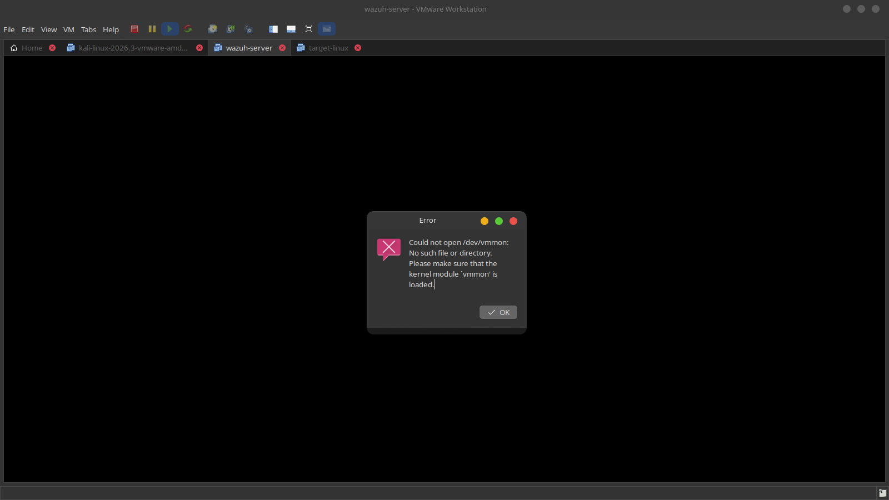
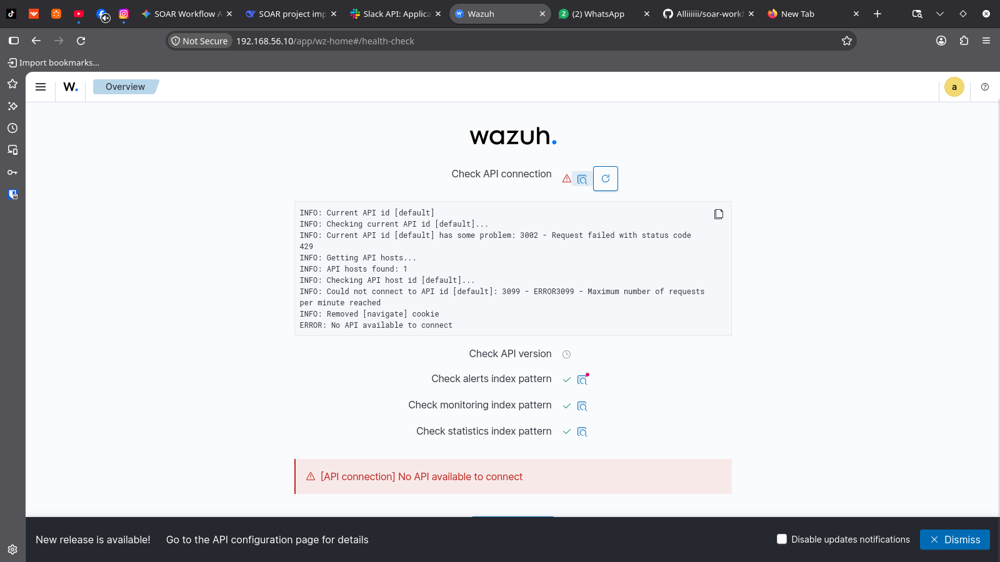
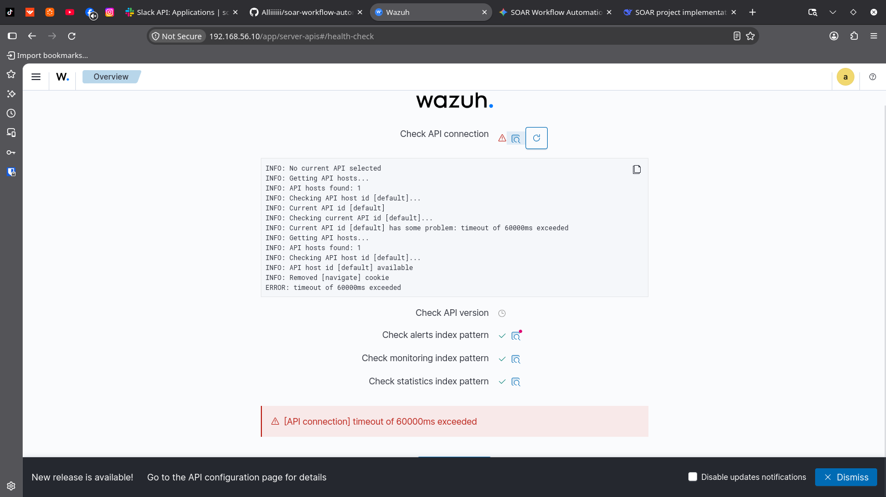

# Troubleshooting

Deployment issues encountered while building the lab and the fixes that were
applied. Each entry records the symptom, root cause, and verified remedy.

---

## 1. VMware Workstation: `/dev/vmmon` missing / monitor initialization failure

**Symptom**

The VMs would not power on after a host kernel update. VMware Workstation
reported that the virtual machine monitor could not be initialized and
`/dev/vmmon` was absent:

```
Could not open /dev/vmmon: No such file or directory.
Please make sure that the kernel module `vmmon` is loaded.
```



**Cause**

The `vmmon` and `vmnet` kernel modules had not been rebuilt for the updated
host Linux kernel. On systems with Secure Boot enabled, the modules can also be
present but refused by the kernel because they are not signed with an enrolled
MOK key.

**Fix**

Rebuild and reinstall the modules, then restart the VMware services:

```bash
sudo vmware-modconfig --console --install-all
sudo systemctl restart vmware
```

If module loading is still blocked, either enrol the Machine Owner Key (MOK)
prompted during the rebuild, or disable Secure Boot in the host firmware
settings and rebuild again. Verify the modules are loaded:

```bash
lsmod | grep -E 'vmmon|vmnet'
ls -l /dev/vmmon /dev/vmnet*
```

---

## 2. Wazuh API HTTP 429 / `ERROR3099` — maximum requests per minute reached

**Symptom**

The dashboard intermittently failed to load data and the API returned HTTP
`429`:

```json
{"title": "Unauthorized", "detail": "Maximum number of requests per minute reached", "error": 3099}
```



The message was most visible during dashboard polling and while the manager was
being restarted repeatedly during rule/integration changes.

**Cause**

The default `max_request_per_minute` value of `300` in
`/var/ossec/api/configuration/api.yaml` was exceeded by the dashboard's polling
combined with repeated service restarts.

**Fix**

Raise the limit under the `access:` block and restart the manager:

```yaml
# /var/ossec/api/configuration/api.yaml
access:
  max_request_per_minute: 1000
```

```bash
sudo systemctl restart wazuh-manager
```

Confirm the API is healthy and the new limit is in effect:

```bash
sudo systemctl status wazuh-manager --no-pager
sudo grep max_request_per_minute /var/ossec/api/configuration/api.yaml
```

> Tune the value to the lab's polling load; `1000` was sufficient here. Do not
> raise it without bound on a production manager.

---

## 3. Wazuh Dashboard: `timeout of 20000ms exceeded` and `wazuh.yml` YAML stream error

**Symptom**

On first login the dashboard showed a request timeout, and after editing the
configuration it refused to start with a YAML parse error:

```
timeout of 20000ms exceeded
```

```
expected a single document in the stream, but found more
```



**Cause**

Two related problems:

1. The default 20 s dashboard-to-API timeout was too short while the manager and
   indexer were still starting up.
2. `timeout: 60000` had been placed **above** the `---` YAML document separator
   in `wazuh.yml`. Everything above `---` is treated as one document, so the
   setting after it produced a second document and the parser rejected the file.

**Fix**

Edit `/usr/share/wazuh-dashboard/data/wazuh/config/wazuh.yml` and place
`timeout` **directly below** the `---` separator, as the first key of the
document:

```yaml
---
timeout: 60000
hosts:
  - default:
      url: https://192.168.56.10
      port: 55000
      username: wazuh-wui
      password: "<redacted>"
      run_as: wazuh-wui
```

Validate the file parses as a single document before restarting:

```bash
sudo python3 -c "import yaml; yaml.safe_load(open('/usr/share/wazuh-dashboard/data/wazuh/config/wazuh.yml'))"
sudo systemctl restart wazuh-dashboard
```

A clean `yaml.safe_load` with no exception confirms the stream error is resolved.
Keep the dashboard's API credentials out of version control and rotate them if
they are ever exposed.

---

## Prevention checklist

- [ ] Rebuild VMware modules (`vmware-modconfig --console --install-all`) after
      every host kernel upgrade.
- [ ] Raise `max_request_per_minute` before running repeated manager restarts or
      heavy dashboard polling.
- [ ] Keep `wazuh.yml` to a single YAML document: put all keys **below** `---`.
- [ ] Validate `wazuh.yml` with `yaml.safe_load` after every edit.
- [ ] Never commit real API passwords or live Slack webhook URLs — use
      `soar/config.yaml.example` as the template.
